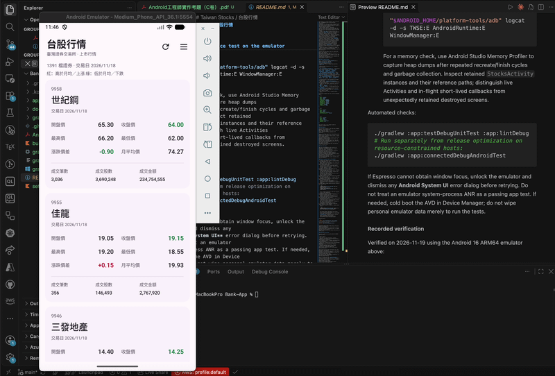
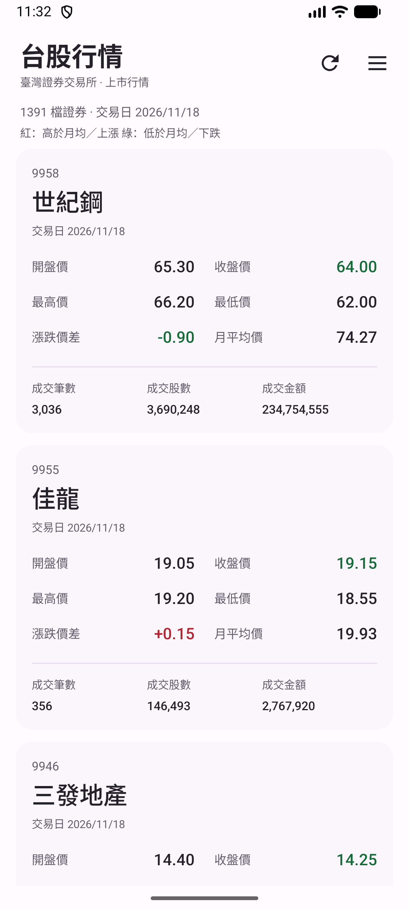
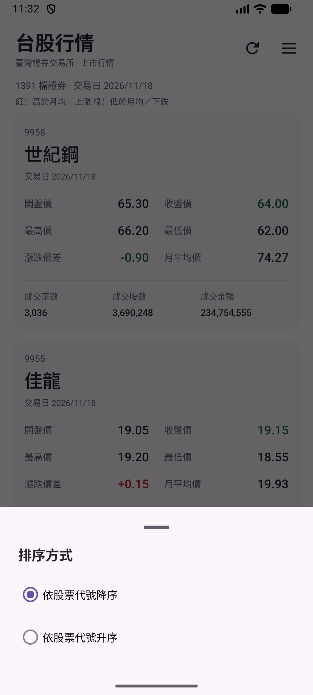
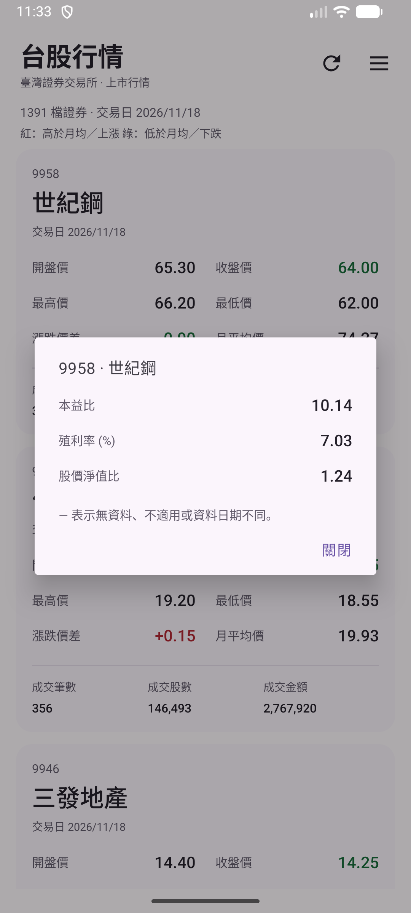
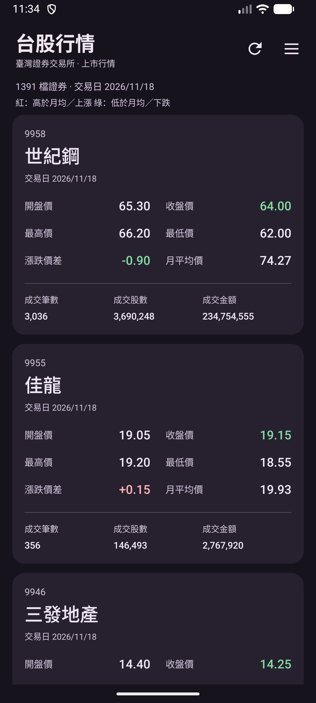
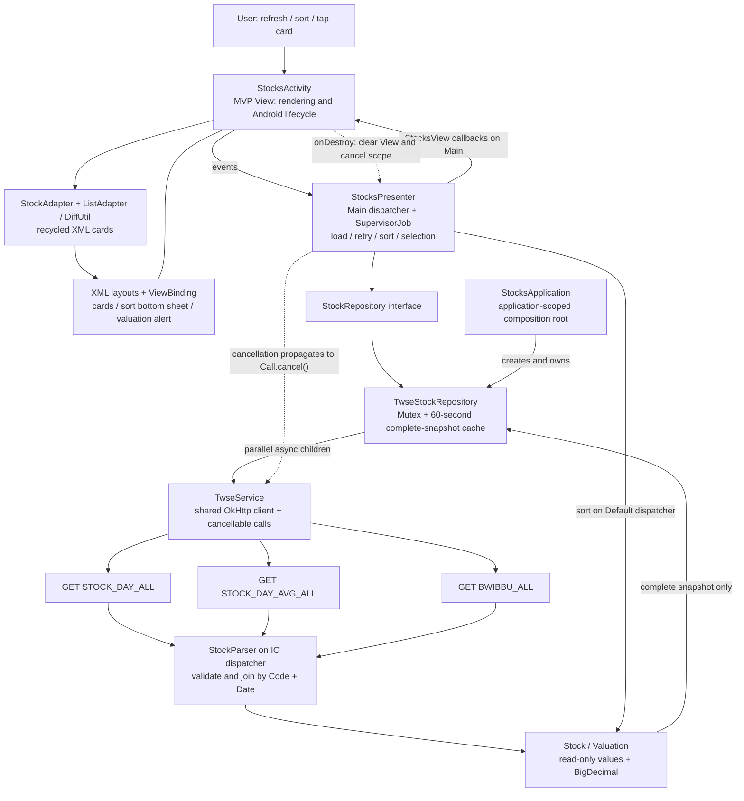
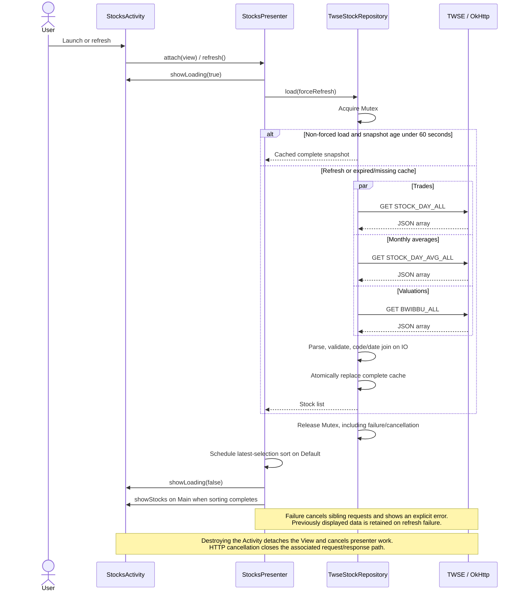

# Taiwan Stocks / 台股行情

Native Kotlin Android application implementing the supplied Android C-paper
exercise with **XML views and MVP**.



[Watch the app demo on YouTube](https://youtu.be/wIm1F6F_xLI)

#### Repeated manual emulator verification

Requested actions:

1. Tap the top-right menu icon to change sorting.
2. Tap a stock card to view valuation ratios.
3. Rotate the emulator.
4. Toggle Android dark mode.
5. Refresh, or disable connectivity to test errors and retry.

Repeated all five actions successfully on 2026-11-19:

1. **Sorting:** changed to ascending (**00400A** first), then back to descending (**9958** first).
2. **Valuation dialog:** tapped **9958 世紀鋼** and verified P/E **10.14**, dividend yield **7.03%**, and P/B **1.24**.
3. **Rotation:** switched to landscape; descending order remained selected.
4. **Dark mode:** enabled and visually checked the landscape screen.
5. **Offline/retry:** disabled emulator Wi-Fi and mobile data, refreshed, and confirmed the error message retained existing cards. Restored connectivity and tapped **Retry**; refresh completed successfully.

Left the app open with **1,391 securities**, in **portrait/light mode**, with
**Wi-Fi, mobile data, and automatic rotation restored**.

## Submission

Suggested demonstration: launch → scroll cards → open the sorting sheet → choose
ascending → tap a stock to show its ratios → close → choose descending → rotate →
switch system dark mode → refresh.

Respect the [TWSE usage terms](https://www.twse.com.tw/zh/page/terms/use.html) and
[data license](https://data.gov.tw/license) when distributing market data.

## Run

- Android Studio with JDK 17 or 21.
- Android SDK 36, Android SDK Platform Tools, and an Android 8.0+ (API 26+) device.
- Open this repository in Android Studio, let Gradle sync, and run `app`.
- For command-line builds, set `ANDROID_HOME` to your SDK directory or let Android
  Studio create the ignored `local.properties`.

From the repository root, use these commands for a clean, non-synced checkout.
If your checkout is cloud-synced, use the macOS commands just below instead.

```sh
./gradlew :app:assembleDebug
./gradlew :app:testDebugUnitTest :app:lintDebug
# Start an emulator or connect a device first:
./gradlew :app:connectedDebugAndroidTest
./gradlew :app:installDebug
# Optimized, unsigned release (configure your own signing for distribution):
./gradlew :app:assembleRelease
```

The installable debug APK is `app/build/outputs/apk/debug/app-debug.apk`.
The Gradle wrapper is included and its distribution checksum is pinned.
No API key or account is required. Network access is required for real data.

**Cloud-synced workspaces (macOS):** keep generated Gradle outputs and the
project cache outside the checkout. Sync conflict copies such as
`activity_stocks 2.xml` can make Android resource processing fail before
building, testing, or installing. Run the following from the repository root:

```sh
gradle_local() {
  ./gradlew \
    -PbuildOutputRoot="$HOME/Library/Caches/TaiwanStocks/build" \
    --project-cache-dir "$HOME/Library/Caches/TaiwanStocks/project-cache" \
    "$@"
}

gradle_local :app:assembleDebug
gradle_local :app:testDebugUnitTest :app:lintDebug
# Start an emulator or connect a device first:
gradle_local :app:connectedDebugAndroidTest
gradle_local :app:installDebug
# Optimized, unsigned release (configure your own signing for distribution):
gradle_local :app:assembleRelease
```

With that override, the debug APK is
`$HOME/Library/Caches/TaiwanStocks/build/app/outputs/apk/debug/app-debug.apk`;
reports also move under that external `app` build directory. The default remains
the standard `app/build` when the property is omitted.

### Emulator: install, launch and inspect

An available AVD on the development machine is `Medium_Phone_API_36.1`
(Android 16, ARM64). AVD names and SDK locations are machine-specific; discover
your own with the first two commands below.

```sh
export ANDROID_HOME="$HOME/Library/Android/sdk" # macOS default
"$ANDROID_HOME/emulator/emulator" -list-avds
"$ANDROID_HOME/platform-tools/adb" devices -l

# If no emulator is running, start one in a separate terminal/window:
"$ANDROID_HOME/emulator/emulator" -avd Medium_Phone_API_36.1

# Once Android has finished booting:
./gradlew :app:assembleDebug
"$ANDROID_HOME/platform-tools/adb" -s emulator-5554 install -r app/build/outputs/apk/debug/app-debug.apk
"$ANDROID_HOME/platform-tools/adb" -s emulator-5554 shell am start -W \
  -n com.polarbeargo.twstocks/.ui.StocksActivity
```

Replace `emulator-5554` with the serial reported by `adb devices -l`. Android Studio's
Device Manager can also start the AVD; choose it in the device selector and press Run.
The installed launcher entry is **台股行情**. A launch outside instrumentation uses
the real TWSE API, not test fixtures.

## Requirements and GUI

| Requirement | Implementation |
| --- | --- |
| Kotlin, XML UI, MVP | Activity implements the view contract; presenter owns screen orchestration; repository owns data |
| PDF stock-card GUI | Rounded pale-purple cards, stock code/name, two-column price grid, and three trading totals |
| Top-right filter icon | Opens a Material bottom sheet with code descending/ascending options; descending is the default |
| Closing-price color | Red above monthly average, green below, neutral when equal or unavailable |
| Price-change color | Positive red, negative green, zero/unavailable neutral; positive values also have a `+` sign |
| Card alert | Material alert showing P/E, dividend yield (%), and P/B; missing ratios are never invented |
| All three endpoints | Concurrent requests; rows joined by security code, not array index |
| Rotation | Saved sorting and RecyclerView scroll restoration; application-scoped short-lived cache avoids redundant completed loads |
| Dark mode | Follows system appearance with separate contrast-aware palettes |
| Animation/UX | RecyclerView diff/move animations, Material ripple, bottom-sheet transitions, loading, retry, refresh and explicit errors |
| Automated verification | Parser/model/formatter, presenter, HTTP/cache/cancellation tests and deterministic Espresso UI tests |

The layout follows pages 3–4 of the supplied PDF, with a compact market header,
trading dates, a color legend and refresh action added for clarity. Totals retain
their full precision (no abbreviated `萬`/`億` values), with labels above the values
to fit phones. Large text wraps instead of being truncated. Opening prices are
neutral: the PDF defines comparison rules only for closing price and change.

### Screenshots from the running app

These are emulator captures using real TWSE data, not design mockups.

| Market cards | Sort bottom sheet |
| --- | --- |
|  |  |

| Valuation alert | System dark mode |
| --- | --- |
|  |  |

## Architecture



The Activity is deliberately thin: business comparisons and joins do not live in
view listeners. The presenter depends on a repository interface and a view
contract, making orchestration testable without an emulator. This is MVP, not an
Activity containing business logic or a ViewModel-based MVVM implementation.



- Presenter entry points and view updates are main-thread confined. Its
  `SupervisorJob` is cancelled and its view reference cleared in `onDestroy`.
  Dialogs/snackbars are dismissed and the RecyclerView adapter detached.
- The application-scoped repository holds no Activity/View/Context references.
  A coroutine `Mutex` protects its entire cache transaction. Non-forced concurrent
  readers reuse a completed snapshot for 60 seconds; manual refresh bypasses it.
  There is no background polling or unbounded historical cache.
- Three requests run concurrently under structured concurrency. A failed request
  cancels its siblings; only a fully parsed snapshot replaces the cache. A failed
  refresh visibly reports the error and retains the previously displayed list.
- OkHttp uses one shared client/connection pool, standard TLS verification,
  HTTPS-only application traffic and bounded connect/read/call timeouts.
  Coroutine cancellation cancels the underlying HTTP call. Responses are closed.
- Network parsing runs on `Dispatchers.IO`; sorting on `Dispatchers.Default`.
  RecyclerView uses `ListAdapter`/`DiffUtil` and resets price colors on every bind.
  Mutable decimal formatters belong to individual main-thread view holders.
- Financial data uses `BigDecimal`, not binary floating point. Comparison occurs
  before formatting. Security codes remain strings, preserving zeros and suffixes.

### Why these implementation choices

| Goal | Concrete implementation | Trade-off / verification |
| --- | --- | --- |
| Efficient work | Build code-indexed maps once; join in O(T + A + V), not nested list scans | Memory is O(T + A + V); one current snapshot is cached, not a growing history |
| Low fetch latency | Three structured `async` requests start together | Network wait is approximately the slowest endpoint rather than their sum; a MockWebServer barrier test verifies concurrency |
| Responsive UI | Parsing off Main, sorting off Main, RecyclerView recycling and background diffs | Does not inflate the entire market as views; no claim of a measured frame-rate guarantee |
| Avoid redundant requests | 60-second monotonic-clock cache, one shared client/pool, no polling | Manual refresh always bypasses the cache; data can be up to 60 seconds old relative to the API snapshot |
| Thread safety | Main-confined presenter/view/formatters, `@MainThread` contracts, mutex-protected cache transactions | Formatters are not global singletons; repository concurrency is tested |
| Reliability | Connect 15 s, read 20 s, total call 30 s; structured cancellation; validate all responses before cache replacement | One failed required endpoint fails the refresh; no misleading partial-success result or automatic retry storm |
| Accurate financial behavior | Exact `BigDecimal` comparisons, string security identifiers, code/date joins, missing values distinct from zero | Endpoint publication is not atomic; differing-date auxiliary rows become unavailable instead of being mixed |
| Leak prevention | No Activity references in application/repository/client; scoped presenter cancellation; detached view/adapter; dismissed dialogs/snackbars; `Response.use` | LeakCanary instrumentation checks repeated recreate/finish cycles; passing this bounded workload does not prove zero leaks in every scenario |
| Smaller distribution | R8 enabled for release; no Compose runtime or reflection-based model serializer | Release signing is intentionally left to the distributor |


### TWSE API specification

Source: [Taiwan Stock Exchange OpenAPI](https://openapi.twse.com.tw/), base URL
`https://openapi.twse.com.tw/v1/`.
The machine-readable contract is
[`swagger.json`](https://openapi.twse.com.tw/v1/swagger.json).

| Method and path (relative to `/v1`) | Purpose | Fields consumed |
| --- | --- | --- |
| `GET /exchangeReport/STOCK_DAY_ALL` | Authoritative stock universe and daily trading data | `Date`, `Code`, `Name`, `TradeVolume`, `TradeValue`, `OpeningPrice`, `HighestPrice`, `LowestPrice`, `ClosingPrice`, `Change`, `Transaction` |
| `GET /exchangeReport/STOCK_DAY_AVG_ALL` | Daily closing price and monthly average | `Date`, `Code`, `MonthlyAveragePrice`; this endpoint also returns `Name` and `ClosingPrice`, but the app uses the trade endpoint for the displayed name and close |
| `GET /exchangeReport/BWIBBU_ALL` | Daily valuation ratios | `Date`, `Code`, `PEratio`, `DividendYield`, `PBratio`; its redundant `Name` is not used |

- No authentication or query parameters are needed for these calls.
- Request header: `Accept: application/json`.
- Each successful response is a top-level JSON array; API numeric values are
  strings, not JSON numbers. Additional fields are ignored.
- `Code` is the join key and stays a string, e.g. `"0050"` or `"00632R"`.
- `Date`, when supplied, is a ROC trading date such as `"1151118"`.
- `DividendYield` is already expressed in percent: `"2.50"` means 2.50%, not 250%.
- Volume is shares, value is TWD, and `Transaction` is the number of trades;
  none is converted to lots or compacted before display.

Illustrative response rows (not a current investment quote):

```json
{
  "Date": "1151118",
  "Code": "2330",
  "Name": "台積電",
  "TradeVolume": "1000000",
  "TradeValue": "950000000",
  "OpeningPrice": "960.00",
  "HighestPrice": "980.00",
  "LowestPrice": "940.00",
  "ClosingPrice": "950.00",
  "Change": "-10.0000",
  "Transaction": "1000"
}
```

```json
{
  "Date": "1151118",
  "Code": "2330",
  "Name": "台積電",
  "ClosingPrice": "950.00",
  "MonthlyAveragePrice": "1000.00"
}
```

```json
{
  "Date": "1151118",
  "Code": "2330",
  "Name": "台積電",
  "PEratio": "20.25",
  "DividendYield": "2.50",
  "PBratio": "5.10"
}
```

Each object above is one element inside its endpoint's response array.

### Data behavior

These are daily snapshots, **not real-time streaming quotes**. The UI displays the
API trading date, converting ROC dates to Gregorian dates. Codes use ordinal
string ordering, including alphanumeric ETF identifiers.

Missing joins/blank values/known unavailable markers appear as `—`, not zero.
An ETF without a valuation remains visible. If dates differ between endpoints,
that stock's auxiliary data is withheld rather than combining different sessions.
Endpoints in the PDF examples may omit dates; two omitted dates can be joined.
Malformed JSON, unexpected numeric text, duplicate codes, empty required datasets
and HTTP failures surface as load/refresh errors and are logged, not silently
converted to successful empty data. No production fixture fallback exists.
Required `Code` fields in all datasets and the trade `Name` must be actual,
nonblank JSON strings. Explicit JSON nulls and other types are rejected without
relying on the differing coercion rules of Android and JVM `org.json`.

### Tests and limits

JVM tests use MockWebServer and coroutine test dispatchers. Instrumented tests
substitute a fixture-only Application through a custom test runner, so UI tests do
not depend on the public API or alter production networking. They exercise sorting,
valuation/missing-value dialogs, recreation/landscape, dark mode and colors.
UI waits are bounded and observe bound data, rather than assuming a fixed network delay.
The Android test libraries support Android 16. Gradle disables system animations
for instrumented tests only; normal launches retain Material animations.

Additional regression and measurement coverage:

- **Cache TTL:** an injected monotonic nanosecond clock tests 60 seconds minus one
  nanosecond, exactly 60 seconds, and 60 seconds plus one nanosecond. The exact
  boundary is expired. Tests also check completion-time timestamps and forced
  refresh resetting the TTL, without sleeping.
- **JSON runtime contract:** the same `src/sharedTest` parser tests compile into
  both JVM and Android suites. They reject missing/null/blank/non-string required
  identifiers and names, and check exact decimals and unavailable ratios.
- **UI state transitions:** a controllable suspended repository verifies loading,
  disabled refresh, initial error, forced retry, changed refresh data, and
  preservation of existing data on refresh failure followed by Snackbar retry.
- **Holder reuse:** a single holder is explicitly rebound through positive,
  negative, neutral, missing, and positive values again. Tests assert colors,
  changed labels, and clearing of all unavailable price/trading-total fields.
- **Leaks:** `StocksLeakTest` uses LeakCanary's `DetectLeaksAfterTestSuccess`.
  Three launch/recreate/finish cycles open sort sheets and valuation dialogs;
  Activities, RecyclerViews, and adapters are explicitly watched (18 objects).
  Retained objects trigger heap analysis and application leaks fail the test.
  LeakCanary is debug-only and excluded from release builds.
- **Performance:** `StocksPerformanceTest` measures a synthetic 1,391-security
  parse/join/sort workload after five warmups, reporting median/p95 over 30
  samples. It validates complete ordering and joins and fails if p95 reaches
  the coarse 2,000 ms regression budget. A separate 1,391-card scroll test
  collects `FrameMetrics.TOTAL_DURATION`, median/p95, frames over a 16.67 ms
  reference, and dropped metric callbacks, requiring at least ten samples.

Performance results are emitted as instrumentation status fields and under the
`StocksPerformance` logcat tag. These are debug/emulator smoke measurements, not
release benchmarks or a 60 fps guarantee. Frame timings are reported rather than
gated against one universal device budget; 16.67 ms is a reference, not a claim
about the device's actual refresh rate. Compare release/profileable measurements
on the same physical device for performance decisions. Leak checks cover the
exercised lifecycle paths, not all possible retention or native-memory leaks.

Run just the automated leak and performance checks (using external build outputs
to avoid generated-file conflict copies in cloud-synced workspaces):

```sh
./gradlew :app:connectedDebugAndroidTest \
  -PbuildOutputRoot="$HOME/Library/Caches/TaiwanStocks/build" \
  --project-cache-dir "$HOME/Library/Caches/TaiwanStocks/project-cache" \
  -Pandroid.testInstrumentationRunnerArguments.class=com.polarbeargo.twstocks.StocksLeakTest,com.polarbeargo.twstocks.StocksPerformanceTest
```

If `parseDebugLocalResources` rejects a generated name such as
`activity_stocks 2.xml`, the build output contains a duplicate/conflict copy;
this is not a failing leak or performance test. Use the external-output command
above rather than editing generated resources. Moving to a non-synced checkout
also avoids this issue.

#### Manual acceptance test on the emulator

1. **Launch with internet access:** loading changes to the TWSE market list; the
   header shows the stock count and API trading date. Data is daily, not live ticks.
2. **Inspect a card:** confirm all six price metrics and all three trading totals
   from the PDF are visible. Close above monthly average is red, below is green;
   positive change is red with `+`, negative change is green, equality is neutral.
3. **Sort:** tap the top-right three-line icon. Descending is initially selected.
   Choose ascending and verify code order, including leading-zero ETF codes; reopen
   the sheet and choose descending. Changing order returns to the top of the list;
   refreshing the same order preserves the current position. Both sheet options
   must be reachable in landscape.
4. **Open an alert:** tap a card. Check P/E, dividend yield (%) and P/B; close it.
   Some ETFs legitimately show `—` because TWSE does not publish their ratios. This is expected missing-data behavior. Showing — is more accurate than inventing values or displaying zero.
5. **Rotate:** use the emulator's rotate controls. Verify the selected ordering
   remains, cards reflow and the previous scroll position is restored. Open dialogs
   intentionally close. A completed fresh snapshot is reused.
6. **Dark mode:** change Android Settings → Display → Dark theme, or use:

   ```sh
   "$ANDROID_HOME/platform-tools/adb" shell cmd uimode night yes
   # Restore light appearance:
   "$ANDROID_HOME/platform-tools/adb" shell cmd uimode night no
   ```

   Verify readable backgrounds, labels and red/green prices in both appearances.
7. **Refresh:** tap the circular-arrow icon. It is disabled while loading to avoid
   repeated refreshes; the list is replaced only after all three endpoints succeed.
8. **Failure and retry:** turn off both emulator Wi-Fi and mobile data, then refresh.
   Existing cards remain with a visible update-failed message and Retry action.
   A cold launch with no cached data shows an error/retry screen. Restore connectivity
   and retry; real data should return. Allow up to the configured 30-second call
   timeout for a non-responsive connection.
9. **Lifecycle:** rotate repeatedly, open/close sheets and alerts, leave the app,
   then return. Check for crashes or “leaked window” errors:

   ```sh
   "$ANDROID_HOME/platform-tools/adb" logcat -d -s TWSE:E AndroidRuntime:E WindowManager:E
   ```

   For a memory check, use Android Studio Memory Profiler to capture heap dumps
   after repeated recreate/finish cycles and garbage collection. Inspect retained
   `StocksActivity` instances and their reference paths; distinguish live Activities
   and in-flight short-lived callbacks from unexpectedly retained destroyed screens.

#### Recorded verification

Verified on 2026-11-19 using the Android 16 ARM64 emulator above:

| Check | Result |
| --- | --- |
| Debug APK build and installation | Passed |
| JVM tests | 26 passed: 9 parser/model/formatter, 3 shared parser-contract, 9 repository/HTTP/TTL, 5 presenter |
| Android instrumented tests | 11 passed: 3 shared parser-contract, 2 existing UI, 2 loading/error/refresh, 1 deterministic holder-reuse, 1 lifecycle leak, 2 performance |
| Automated lifecycle leak check | Passed after three launch/recreate/finish cycles and 18 explicit watches; LeakCanary reported no retained objects after its retained delay |
| Parse/join/sort measurement | Synthetic 1,391 securities; 5 warmups, 30 samples; median 94.06 ms, p95 204.93 ms (2,000 ms smoke budget) |
| Scroll frame measurement | 101 frames; median 17.75 ms, p95 71.20 ms; 93 frames over the 16.67 ms reference; 0 dropped metric callbacks |
| Android lint | Passed with 0 errors and 10 warnings (dependency-version and backup-configuration advisories) |
| Optimized unsigned release build | Passed |
| Production API smoke check | Loaded 1,391 securities for trading date 2026/11/18; public-network timeouts can still occur and are surfaced with Retry |

These results describe this verification run, not a guarantee of upstream API
availability. No production heap-leak or performance benchmark certification is claimed.
The measurements above are from a debug Android 16 ARM64 emulator run with host
graphics and Vulkan disabled after system UI/graphics stalls in earlier attempts.
Frame results do not demonstrate 60 fps; physical-device release profiling remains
necessary. LeakCanary only certifies no detected retention in the exercised paths.
The emulator was left with the production debug app installed; Gradle device tests
may uninstall their app packages on completion, so reinstall the debug APK afterward
when doing manual testing.

Reports are generated under `app/build/reports/`.
Lifecycle cancellation and ownership are designed to avoid leaks, but no finite
test run can guarantee zero leaks, perfect uptime or maximum speed on every device.
Profile on the target hardware before making production performance guarantees.
The cache is in-memory only; process death refetches data. An in-flight load is
cancelled on rotation and restarted by the replacement screen; a completed fresh
load is reused. Open dialogs close on recreation.